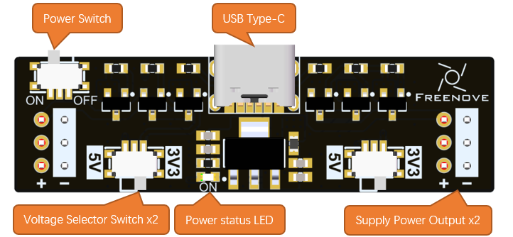
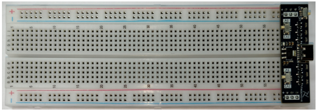

##############################################################################
Instructions for Use
##############################################################################

**Welcome to use the Freenove Power Supply for Breadboard.**

Here are its key features:

* **Breadboard Compatibility:** Compatible with standard MB-102 breadboards (830/850 tie points).

* **Interface Type:** USB Type-C (5V input; supports USB Type-C to Type-C cables).

* **Protection:** Onboard resettable fuse for protection against short circuits and overcurrent.

* Output Channels: Two independent power outputs, each selectable between 5V and 3.3V using the onboard switch.

* **3.3V Voltage Regulation:** Uses an onboard 1117-3.3V linear voltage regulator (LDO). The regulator generates heat during voltage conversion. Higher input-to-output voltage differences and output currents result in greater heat generation. Therefore, the maximum continuous output current is limited by the regulator's thermal dissipation capability.

* **Power Output:** 5V, up to 1A (maximum); 3.3V, up to 0.5A(maximum).

* **Indicator Lights:** Onboard power status LED.

To install the power supply module on a breadboard, refer to the figure below:

If you encounter any issues, feel free to contact us for prompt and free technical support.

support@freenove.com
